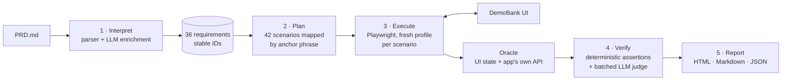

# Spec-driven QA agent for DemoBank

An autonomous QA agent that reads a product spec (`PRD.md`), operates the web app in a real
browser, and reports **passed / failed / unverified** for every requirement, with reproduction
steps, expected-vs-observed values, screenshots and network evidence, plus an itemised cost report.

```
python -m qa_agent --url <app-url> --prd ../test-website/PRD.md
```

**Latest local run:** 36 requirements · 42 scenarios (17 positive / 12 negative / 13 edge) ·
190 assertions · **31 passed, 5 failed, 0 unverified** · ~2 minutes · ~$0.04 LLM cost on the first
run, ~$0.001 on repeat runs (PRD analysis is cached).

---

## How it works

The agent runs the five-stage loop from the hackathon brief: **Interpret → Plan → Execute → Verify → Report**.



| Stage | What happens | Where |
|---|---|---|
| **Interpret** | A deterministic Markdown parser turns each PRD bullet / normative sentence into a requirement with a stable ID (`TRF-04`). An optional single LLM call (Sonnet) breaks each one into atomic assertions and test ideas; the result is cached. | `prd.py` |
| **Plan** | 42 scenarios, each tagged positive / negative / edge. Scenarios name PRD **anchor phrases** ("start and end dates are inclusive"), not hard-coded IDs, so the mapping survives PRD edits. Data-driven: dates, amounts and account names are derived from live data, not hard-coded. | `suites/*.py`, `harness.py` |
| **Execute** | Each scenario runs in a fresh browser profile. Locators are semantic (role / label / text) with ordered fallbacks; if all fail, the ARIA snapshot goes to Haiku to *heal* the locator. Waits are condition-based (spinners gone, network idle), never fixed sleeps. | `browser.py`, `flows.py` |
| **Verify** | A click "working" is never a pass. Every mutating scenario snapshots state **before and after** and asserts on side effects: exact balance deltas, records created or not, both account histories, persistence after refresh. Subjective checks ("clear message") are queued and graded in **one** batched LLM call. | `suites/*.py`, `judge.py` |
| **Report** | Requirement verdicts are rolled up from assertions (`failed` beats `passed`; no reliable observation = `unverified`). Defects get severity, repro steps, expected vs observed, inline screenshots and captured API responses. | `models.py`, `report.py` |

### The oracle: how the agent knows what's true

The agent cross-checks two independent views of state:
1. **UI state:** what a user sees (card balances, table rows), parsed from visible text.
2. **API state:** what the app's own backend returns for the same session cookie. The agent finds the API base URL itself by watching network traffic. It is read-only, apart from clearly labelled restore transfers (below).

A defect is reported when the UI, the backend, or both contradict the PRD. Example: the negative-amount
transfer shows "Transfer complete" (UI) **and** checking goes $4,369.75 → $4,374.75 (backend).

### Resilience features
- **Self-healing locators:** ordered fallback strategies, then an LLM proposal from the ARIA tree. Each fix is verified (it must be visible) and remembered for the rest of the run.
- **`--chaos` mode:** renames form labels and buttons at runtime ("Amount" → "Value", "Transfer funds" → "Send money"). Normal and chaos runs produce **identical verdicts** on all 36 requirements, with 38 automatic recoveries.
- **Safe retries:** a scenario that errors is retried once in a fresh profile, *unless* it already sent a transfer (a retry could double-move money).
- **Preflight:** fails fast with a clear message if the target is unreachable.
- **Shared-environment safety:** every transfer carries a unique memo `QA-<run>-<scenario>`; records are matched by that memo, and unexpected foreign transactions downgrade a verdict to *unverified* instead of producing a false failure.
- **Test hygiene:** after each mutating scenario, any balance drift is reversed with a labelled compensating transfer, so later scenarios start from known balances. Every compensation is listed in the report.
- **Client-side fault injection:** HTTP 500/503 responses are simulated *inside our own browser* (Playwright routing) to test error recovery. The server is never stressed.

---

## Findings on the local build

| # | Severity | Requirement | Finding |
|---|---|---|---|
| D1 | Critical | TRF-05 | Overdraft allowed: transferring balance + $0.01 succeeds; checking ends at **−$0.01**. |
| D2 | Critical | TRF-04 | Negative amount `-5.00` accepted; money moves in reverse and "Transfer complete" is shown. |
| D3 | Critical | TRF-04 | Zero amount (`0`, `0.00`) accepted; a $0.00 completed transfer record is created. |
| D4 | Medium | HIS-04 | End date is exclusive: a transaction on the end date is missing (start date is inclusive). |
| D5 | Medium | HIS-02 | Pending/failed rows show **$0.00** instead of their amount (e.g. $700 failed deposit). |

The hosted target may contain different defects; the agent finds them from the PRD alone.

---

## Setup

First time? Follow **[GETTING_STARTED.md](GETTING_STARTED.md)** (Windows + Mac, step by step).

Requirements: Python 3.11+, Chromium via Playwright.

```bash
cd agent
python -m venv .venv && source .venv/bin/activate        # Windows: .venv\Scripts\Activate.ps1
pip install -r requirements.txt
python -m playwright install chromium
cp .env.example .env    # then paste GROQ_API_KEY=... (free prototype) or ANTHROPIC_API_KEY=...
```

The provider is chosen automatically from whichever key is set (`--provider groq|anthropic` to force it).
Without a key the agent runs in offline mode with deterministic fallbacks.

Run:

```bash
python -m qa_agent --url https://<hosted-demobank> --prd ../test-website/PRD.md          # full run
python -m qa_agent --url ... --prd ... --headed                                           # watch it (demo video)
python -m qa_agent --url ... --prd ... --only transfers HIS-                              # subset
python -m qa_agent --url ... --prd ... --chaos                                            # resilience demo
python -m qa_agent --url ... --prd ... --offline                                          # no LLM calls at all
```

Output: `runs/run-<timestamp>/report.html` (judges), `report.md` (GitHub), `report.json` (machines),
`requirements.json` (interpreted PRD) and `screenshots/`.

Local target: follow `../test-website/LOCAL_SETUP.md`. `devtools/` contains a dev-only stand-in
used when pip/npm/Docker are unavailable (see `devtools/standin_backend.py`); the agent never imports it.

Tests: `python -m pytest -q tests`

---

## Cost

The LLM is used only where judgement is needed. Navigation, clicking and assertions are plain
code and cost nothing.

| Call | Model | When | Est. tokens (in/out) | Est. cost |
|---|---|---|---|---|
| PRD enrichment | Sonnet 5.5 | once per PRD version (cached) | ~1.5k / ~3.2k | ~$0.035 |
| Message clarity judge | Haiku 5.5 | one batched call per run | ~0.8k / ~0.2k | ~$0.0002 |
| Executive summary | Haiku 5.5 | one call per run | ~1.3k / ~0.6k | ~$0.0004 |
| Locator healing | Haiku 5.5 | only when all strategies fail (0 in normal runs) | ~2k / ~0.05k each | ~$0.0002 each |

**≈ $0.036 for the first run, ≈ $0.001 for later runs** (Claude).

**Prototype on Groq, report the Claude cost.** Using the free Groq tier (default `llama-3.3-70b-versatile`),
the ledger records real token counts per call and prices them twice: at Groq's list price (billed $0 on the
free tier) and as a **Claude-equivalent** (same tokens on Haiku 5.5 / Sonnet 5.5). Tokenizers differ between
model families, so treat the Claude-equivalent as an estimate (roughly ±30%). Prices from the Claude pricing page
(Haiku 5.5 $0.10 / $0.50 and Sonnet 5.5 $2 / $10 per million tokens, Oct 2026); override them with
`QA_PRICES`. Every report includes an itemised ledger of actual calls, tokens, cache hits and USD.
Offline runs record what each skipped call *would* have cost.

---

## Project layout

```
qa_agent/
  __main__.py     CLI
  runner.py       orchestrates the loop, retries, restore, preflight
  prd.py          PRD → requirements (parser + optional LLM enrichment), anchor resolution
  harness.py      @scenario registry, Ctx (steps, evidence, assertions, judge queue)
  browser.py      Playwright driver: self-healing find(), settle(), network capture, chaos mode
  flows.py        user flows (enter demo, transfer, filters) + UI/API state readers
  judge.py        batched clarity judge + executive summary (with offline heuristics)
  llm.py          minimal LLM client (Claude or Groq): cost ledger, Claude-equivalent pricing, disk cache
  report.py       HTML / Markdown / JSON reports, severity triage
  models.py       Requirement, Scenario, Assertion, Evidence + verdict roll-up
  suites/         session · accounts · history · transfers · profile_ui
tests/            unit tests (no browser needed)
devtools/         dev-only local target helpers
```

## Known limitations
- Shared hosted environment: if other users change balances during a run, affected checks become *unverified* rather than failing. Restore transfers leave labelled records in history.
- "Clear message" judgements are subjective; offline mode uses a documented keyword heuristic.
- The UI is the primary interface; the app's API is used as a read-only oracle and for labelled restore transfers, never to perform the behaviour under test.
- No load or security testing beyond the PRD's privacy requirements (out of scope by the rules).
