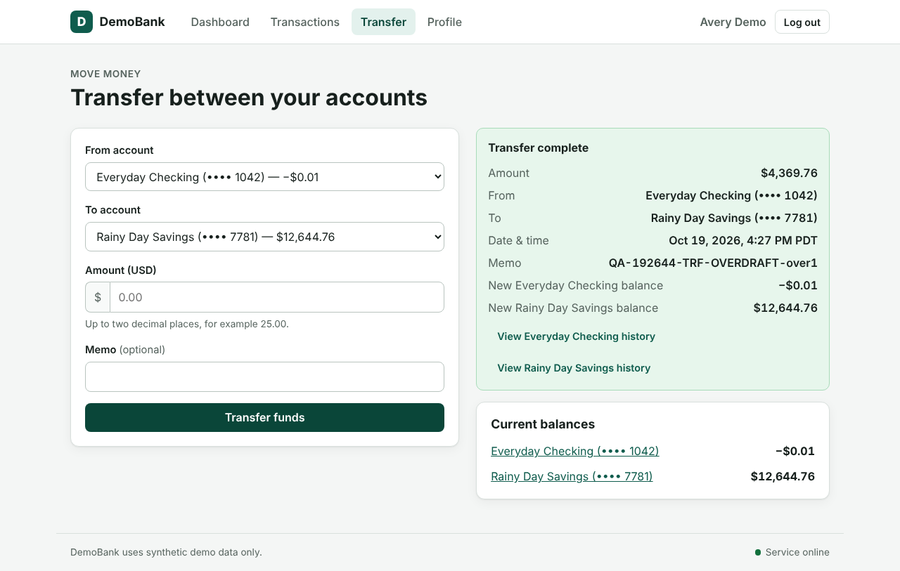
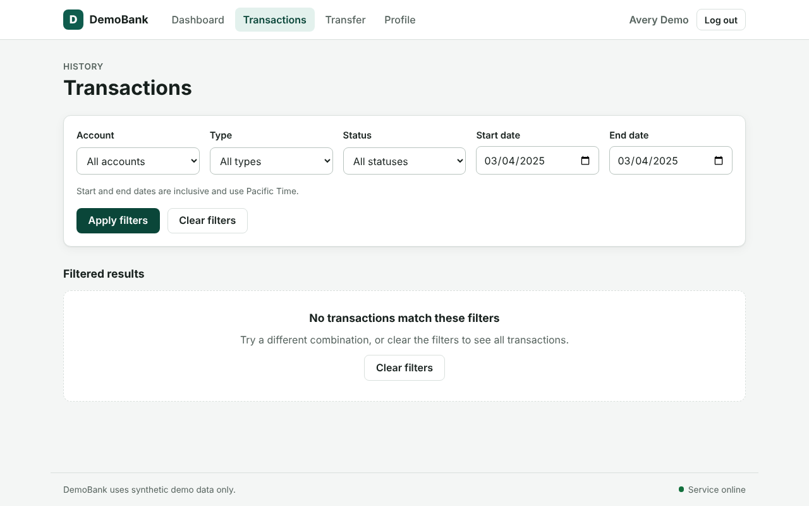
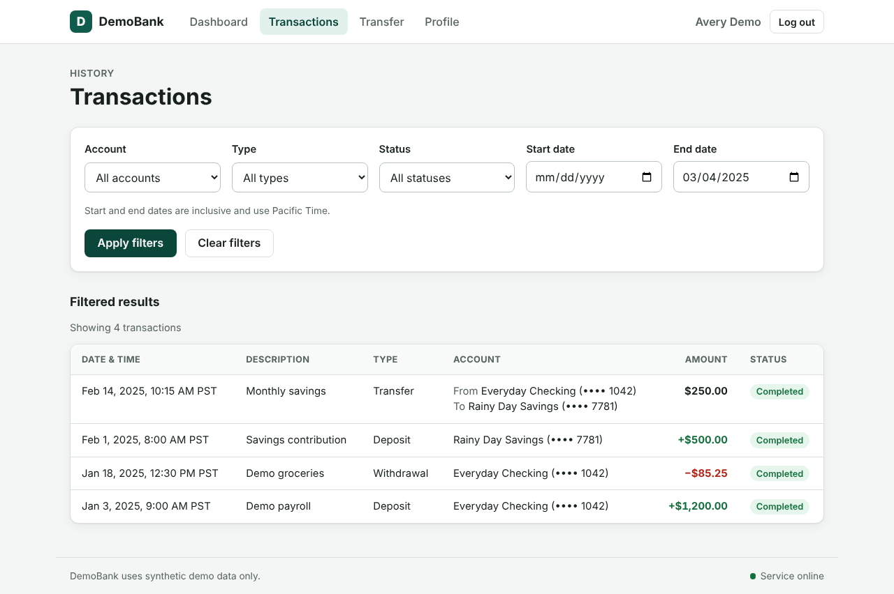
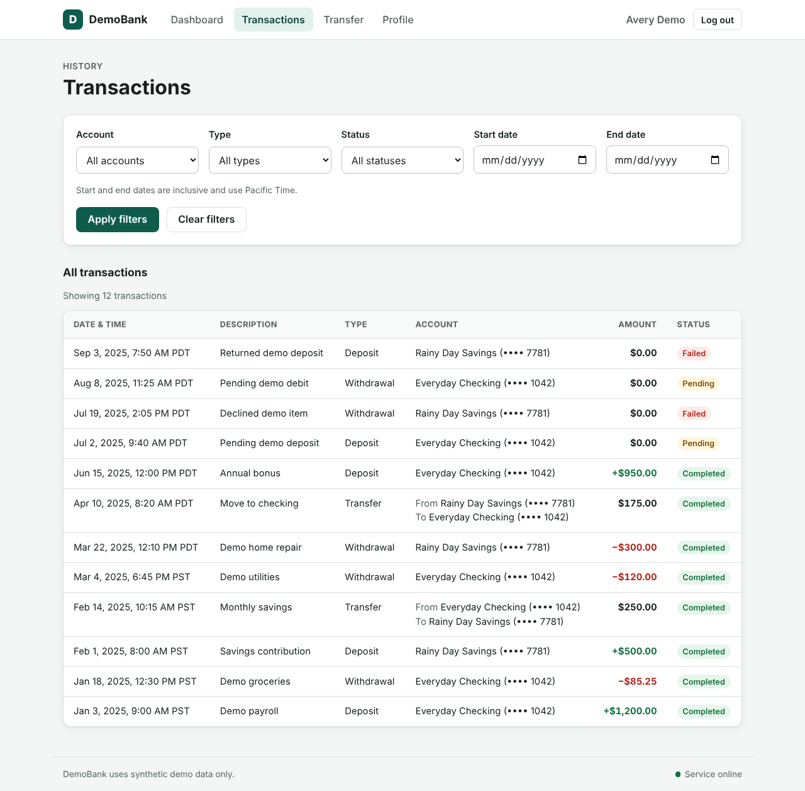

# DemoBank QA audit report

**Target:** http://localhost:5173  |  **Run:** 2026-10-19T19:26:44  |  **Duration:** 115.9 s  |  **LLM mode:** offline

| Passed | Failed | Unverified | Scenarios | LLM cost |
|---|---|---|---|---|
| 31 | 5 | 0 | 42 | $0.0000 |

## Executive summary

31 requirements passed, 5 failed and 0 could not be verified. Failing scenarios: HIS-ROWS, HIS-DATE-BOUNDARY, TRF-OVERDRAFT, TRF-AMT-NEG, TRF-AMT-ZERO, TRF-AMT-ZERO2. Each failure below lists reproduction steps, expected vs observed values and evidence.

## Requirement coverage

| ID | Requirement | Verdict | Reason |
|---|---|---|---|
| GEN-01 | The application must never initiate real payments or connect to an external bank. | **PASS** | 1 assertion(s) passed across 1 scenario(s) |
| SES-01 | The target has one seeded demo customer. | **PASS** | 1 assertion(s) passed across 1 scenario(s) |
| SES-02 | The landing page provides a clearly labeled Enter Demo action. It opens the demo dashboard without requiring a password or real identity inf | **PASS** | 3 assertion(s) passed across 1 scenario(s) |
| SES-03 | The header identifies the active demo customer and provides a Log out action. | **PASS** | 2 assertion(s) passed across 1 scenario(s) |
| SES-04 | Logging out returns the user to the landing page. Protected dashboard views should not remain usable after logout; direct navigation to them | **PASS** | 12 assertion(s) passed across 2 scenario(s) |
| SES-05 | Refreshing while in a valid demo session should preserve that session. A logged-out user must not regain access merely by refreshing a prote | **PASS** | 4 assertion(s) passed across 2 scenario(s) |
| DSH-01 | The dashboard shows the customer's checking and savings accounts. | **PASS** | 1 assertion(s) passed across 1 scenario(s) |
| DSH-02 | Each account displays a readable account name, a masked account identifier, account type, and current available balance in USD. | **PASS** | 2 assertion(s) passed across 1 scenario(s) |
| DSH-03 | Balances are displayed to two decimal places. The UI must not expose a full account identifier. | **PASS** | 8 assertion(s) passed across 2 scenario(s) |
| DSH-04 | Selecting an account opens an account detail view with its current balance and related transaction history. | **PASS** | 2 assertion(s) passed across 1 scenario(s) |
| DSH-05 | Account balances shown on the dashboard and detail view must agree with the latest successful transactions. | **PASS** | 5 assertion(s) passed across 3 scenario(s) |
| TRF-01 | The user can transfer funds between the checking and savings accounts owned by the demo customer. | **PASS** | 2 assertion(s) passed across 2 scenario(s) |
| TRF-02 | The transfer form includes source account, destination account, amount, and an optional memo. | **PASS** | 3 assertion(s) passed across 2 scenario(s) |
| TRF-03 | The source and destination must be different accounts. Same-account transfers must be rejected with a clear explanation and must not alter b | **PASS** | 4 assertion(s) passed across 1 scenario(s) |
| TRF-04 | Amount must be a positive number greater than zero, with no more than two digits after the decimal point. Blank, zero, negative, non-numeric | **FAIL** | 7 failing assertion(s), e.g. a negative amount ('-5.00'): the transfer is rejected |
| TRF-05 | The amount must not exceed the source account's available balance. If funds are insufficient, the transfer must be rejected, both balances m | **FAIL** | 3 failing assertion(s), e.g. amount $4369.76 (balance + $0.01): the transfer is rejected |
| TRF-06 | A valid transfer is atomic: the source balance decreases by the amount and the destination balance increases by the same amount. No partial  | **PASS** | 3 assertion(s) passed across 3 scenario(s) |
| TRF-07 | A successful transfer creates one completed transfer record that can be found in both relevant account histories. The record shows the amoun | **PASS** | 5 assertion(s) passed across 2 scenario(s) |
| TRF-08 | The UI reports success only after the transfer has been committed. If a transfer is rejected or fails, the UI must explain that it did not c | **FAIL** | 4 failing assertion(s), e.g. amount $4369.76 (balance + $0.01): no success state is shown |
| TRF-09 | Refreshing after a successful transfer must preserve the updated balances and transaction record. | **PASS** | 1 assertion(s) passed across 1 scenario(s) |
| HIS-01 | The user can view a combined transaction history and account-specific history. | **PASS** | 5 assertion(s) passed across 2 scenario(s) |
| HIS-02 | Each row shows date and time, description or memo, transaction type, amount, status, and relevant account. Amount direction should be clear  | **FAIL** | 1 failing assertion(s), e.g. Each row's amount equals the transaction amount |
| HIS-03 | The user can filter history by account, transaction type, status, and date range. When filters are applied, every displayed row must satisfy | **PASS** | 21 assertion(s) passed across 3 scenario(s) |
| HIS-04 | The start and end dates are inclusive. A transaction occurring on either boundary date must be included when it matches the other filters. | **FAIL** | 6 failing assertion(s), e.g. start = end = that day: includes Demo utilities (2025-03-05T02:45:00Z UTC = 2025-03-04 PT) |
| HIS-05 | An empty result set must show a clear empty state, not an error or unrelated transactions. | **PASS** | 2 assertion(s) passed across 1 scenario(s) |
| HIS-06 | Clearing filters restores the unfiltered history. | **PASS** | 2 assertion(s) passed across 1 scenario(s) |
| PRF-01 | A profile view displays only synthetic demo-customer details, such as display name and a masked email address. | **PASS** | 2 assertion(s) passed across 1 scenario(s) |
| PRF-02 | The view must not reveal passwords, authentication tokens, full account identifiers, or data belonging to another user. | **PASS** | 2 assertion(s) passed across 1 scenario(s) |
| UI-01 | The target works in a current desktop browser at a 1280 × 800 viewport and remains usable at narrower widths. | **PASS** | 9 assertion(s) passed across 1 scenario(s) |
| UI-02 | Interactive controls have readable labels and communicate loading, success, validation, and failure states. | **PASS** | 6 assertion(s) passed across 2 scenario(s) |
| UI-03 | A submitted action should not silently disappear. While waiting, the UI should show a loading state or otherwise prevent accidental duplicat | **PASS** | 2 assertion(s) passed across 1 scenario(s) |
| UI-04 | Navigation links and buttons lead to the labeled destination or perform the labeled action. | **PASS** | 8 assertion(s) passed across 1 scenario(s) |
| UI-05 | A recoverable error must leave the user able to retry or return to the dashboard. | **PASS** | 5 assertion(s) passed across 3 scenario(s) |
| SEED-01 | The demo begins with one customer, one checking account, one savings account, and enough historical transactions to exercise account, type,  | **PASS** | 2 assertion(s) passed across 1 scenario(s) |
| SEED-02 | Seed records should include multiple dates and at least one transfer between the two accounts. | **PASS** | 1 assertion(s) passed across 1 scenario(s) |
| SEED-03 | The demo has no signup, external payment, bill-pay, loan, card, or multi-user features. | **PASS** | 1 assertion(s) passed across 1 scenario(s) |

## Defects

### D1. [Critical] Reject a negative amount ('-5.00')  (`TRF-AMT-NEG`, negative)

**Requirements:** TRF-04, TRF-08

**Steps to reproduce**

1. Open the app in a fresh browser profile and click 'Enter Demo'
2. Transfer form: from 'Everyday Checking' to 'Rainy Day Savings', amount '-5.00', memo 'QA-192644-TRF-AMT-NEG-amt1' -> submit

- **a negative amount ('-5.00'): the transfer is rejected**  
  Expected: validation/error message, no success  
  Observed: SUCCESS shown; API 201; messages: Transfer complete Amount −$5.00 From Everyday Checking (•••• 1042) To Rainy Day Savings (•••• 7781) Date & time Oct 19, 2026, 4:27 PM PDT Memo QA-192644-TRF-AMT
- **a negative amount ('-5.00'): no success state is shown**  
  Expected: no 'Transfer complete'  
  Observed: SUCCESS shown; API 201; messages: Transfer complete Amount −$5.00 From Everyday Checking (•••• 1042) To Rainy Day Savings (•••• 7781) Date & time Oct 19, 2026, 4:27 PM PDT Memo QA-192644-TRF-AMT
- **A negative amount ('-5.00'): balances are unchanged**  
  Expected: both balances unchanged  
  Observed: {'Everyday Checking': '$4369.75 → $4374.75', 'Rainy Day Savings': '$8275.00 → $8270.00'}
- **A negative amount ('-5.00'): no transaction record is created**  
  Expected: 0 new records  
  Observed: transfer completed $-5.00

### D2. [Critical] Reject zero ('0')  (`TRF-AMT-ZERO`, negative)

**Requirements:** TRF-04, TRF-08

**Steps to reproduce**

1. Open the app in a fresh browser profile and click 'Enter Demo'
2. Transfer form: from 'Everyday Checking' to 'Rainy Day Savings', amount '0', memo 'QA-192644-TRF-AMT-ZERO-amt1' -> submit

- **zero ('0'): the transfer is rejected**  
  Expected: validation/error message, no success  
  Observed: SUCCESS shown; API 201; messages: Transfer complete Amount $0.00 From Everyday Checking (•••• 1042) To Rainy Day Savings (•••• 7781) Date & time Oct 19, 2026, 4:28 PM PDT Memo QA-192644-TRF-AMT-
- **zero ('0'): no success state is shown**  
  Expected: no 'Transfer complete'  
  Observed: SUCCESS shown; API 201; messages: Transfer complete Amount $0.00 From Everyday Checking (•••• 1042) To Rainy Day Savings (•••• 7781) Date & time Oct 19, 2026, 4:28 PM PDT Memo QA-192644-TRF-AMT-
- **Zero ('0'): no transaction record is created**  
  Expected: 0 new records  
  Observed: transfer completed $0.00

### D3. [Critical] Reject zero ('0.00')  (`TRF-AMT-ZERO2`, edge)

**Requirements:** TRF-04, TRF-08

**Steps to reproduce**

1. Open the app in a fresh browser profile and click 'Enter Demo'
2. Transfer form: from 'Everyday Checking' to 'Rainy Day Savings', amount '0.00', memo 'QA-192644-TRF-AMT-ZERO2-amt1' -> submit

- **zero ('0.00'): the transfer is rejected**  
  Expected: validation/error message, no success  
  Observed: SUCCESS shown; API 201; messages: Transfer complete Amount $0.00 From Everyday Checking (•••• 1042) To Rainy Day Savings (•••• 7781) Date & time Oct 19, 2026, 4:28 PM PDT Memo QA-192644-TRF-AMT-
- **zero ('0.00'): no success state is shown**  
  Expected: no 'Transfer complete'  
  Observed: SUCCESS shown; API 201; messages: Transfer complete Amount $0.00 From Everyday Checking (•••• 1042) To Rainy Day Savings (•••• 7781) Date & time Oct 19, 2026, 4:28 PM PDT Memo QA-192644-TRF-AMT-
- **Zero ('0.00'): no transaction record is created**  
  Expected: 0 new records  
  Observed: transfer completed $0.00

### D4. [Critical] Amount one cent above the available balance is rejected  (`TRF-OVERDRAFT`, negative)

**Requirements:** TRF-05, TRF-08

**Steps to reproduce**

1. Open the app in a fresh browser profile and click 'Enter Demo'
2. Transfer form: from 'Everyday Checking' to 'Rainy Day Savings', amount '4369.76', memo 'QA-192644-TRF-OVERDRAFT-over1' -> submit

- **amount $4369.76 (balance + $0.01): the transfer is rejected**  
  Expected: validation/error message, no success  
  Observed: SUCCESS shown; API 201; messages: Transfer complete Amount $4,369.76 From Everyday Checking (•••• 1042) To Rainy Day Savings (•••• 7781) Date & time Oct 19, 2026, 4:27 PM PDT Memo QA-192644-TRF-
- **amount $4369.76 (balance + $0.01): no success state is shown**  
  Expected: no 'Transfer complete'  
  Observed: SUCCESS shown; API 201; messages: Transfer complete Amount $4,369.76 From Everyday Checking (•••• 1042) To Rainy Day Savings (•••• 7781) Date & time Oct 19, 2026, 4:27 PM PDT Memo QA-192644-TRF-
- **Insufficient funds: balances are unchanged**  
  Expected: both balances unchanged  
  Observed: {'Everyday Checking': '$4369.75 → $-0.01', 'Rainy Day Savings': '$8275.00 → $12644.76'}
- **Insufficient funds: no transaction record is created**  
  Expected: 0 new records  
  Observed: transfer completed $4369.76

### D5. [Medium] Start and end dates are inclusive (including Pacific-time edge cases)  (`HIS-DATE-BOUNDARY`, edge)

**Requirements:** HIS-04

**Steps to reproduce**

1. Open the app in a fresh browser profile and click 'Enter Demo'
2. Filter dates: start = end = that day [2025-03-04 → 2025-03-04] and look for Demo utilities (2025-03-05T02:45:00Z UTC = 2025-03-04 PT)
3. Filter dates: start = that day [2025-03-04 → …] and look for Demo utilities (2025-03-05T02:45:00Z UTC = 2025-03-04 PT)
4. Filter dates: end = that day [… → 2025-03-04] and look for Demo utilities (2025-03-05T02:45:00Z UTC = 2025-03-04 PT)
5. Filter dates: start = end = that day [2025-09-03 → 2025-09-03] and look for Returned demo deposit (2025-09-03T14:50:00Z UTC = 2025-09-03 PT)
6. Filter dates: start = that day [2025-09-03 → …] and look for Returned demo deposit (2025-09-03T14:50:00Z UTC = 2025-09-03 PT)
7. Filter dates: end = that day [… → 2025-09-03] and look for Returned demo deposit (2025-09-03T14:50:00Z UTC = 2025-09-03 PT)
8. Filter dates: start = end = that day [2025-08-08 → 2025-08-08] and look for Pending demo debit (2025-08-08T18:25:00Z UTC = 2025-08-08 PT)
9. Filter dates: start = that day [2025-08-08 → …] and look for Pending demo debit (2025-08-08T18:25:00Z UTC = 2025-08-08 PT)
10. Filter dates: end = that day [… → 2025-08-08] and look for Pending demo debit (2025-08-08T18:25:00Z UTC = 2025-08-08 PT)

- **start = end = that day: includes Demo utilities (2025-03-05T02:45:00Z UTC = 2025-03-04 PT)**  
  Expected: transaction included  
  Observed: missing (0 rows shown)
- **end = that day: includes Demo utilities (2025-03-05T02:45:00Z UTC = 2025-03-04 PT)**  
  Expected: transaction included  
  Observed: missing (4 rows shown)
- **start = end = that day: includes Returned demo deposit (2025-09-03T14:50:00Z UTC = 2025-09-03 PT)**  
  Expected: transaction included  
  Observed: missing (0 rows shown)
- **end = that day: includes Returned demo deposit (2025-09-03T14:50:00Z UTC = 2025-09-03 PT)**  
  Expected: transaction included  
  Observed: missing (11 rows shown)
- **start = end = that day: includes Pending demo debit (2025-08-08T18:25:00Z UTC = 2025-08-08 PT)**  
  Expected: transaction included  
  Observed: missing (0 rows shown)
- **end = that day: includes Pending demo debit (2025-08-08T18:25:00Z UTC = 2025-08-08 PT)**  
  Expected: transaction included  
  Observed: missing (10 rows shown)

### D6. [Medium] Combined history shows every transaction with complete, correct row details  (`HIS-ROWS`, positive)

**Requirements:** HIS-02

**Steps to reproduce**

1. Open the app in a fresh browser profile and click 'Enter Demo'
2. Open /transactions without filters and read every table row

- **Each row's amount equals the transaction amount**  
  Expected: row amount = record amount  
  Observed: ["Returned demo deposit (failed deposit): shows 'No change:\\n$0.00', record amount $700.00", "Pending demo debit (pending withdrawal): shows 'No change:\\n$0.00', record amount $125.00", "Declined demo item (failed withdrawal): shows 'No change:\\n$0.00', record amount $900.00", "Pending demo deposit (pending deposit): shows 'No change:\\n$0.00', record amount $400.00"]

## Cost and efficiency

| Purpose | Model | Calls | Cached | In tokens | Out tokens | USD |
|---|---|---|---|---|---|---|
| prd_enrichment (estimated) | claude-sonnet-5-5 | 1 | 0 | 1528 | 3200 | $0.0351 |
| clarity_judge (estimated) | claude-haiku-5-5 | 1 | 0 | 788 | 152 | $0.0002 |
| executive_summary (estimated) | claude-haiku-5-5 | 1 | 0 | 1296 | 600 | $0.0004 |

Browser actions: 261. API responses captured: 568. Locator heals: 0. Fallback steps: prd_enrichment, clarity_judge, executive_summary.
